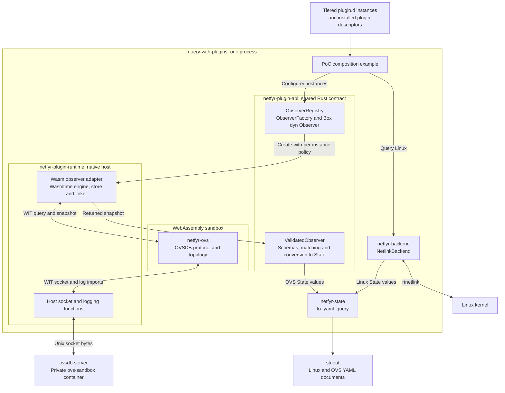
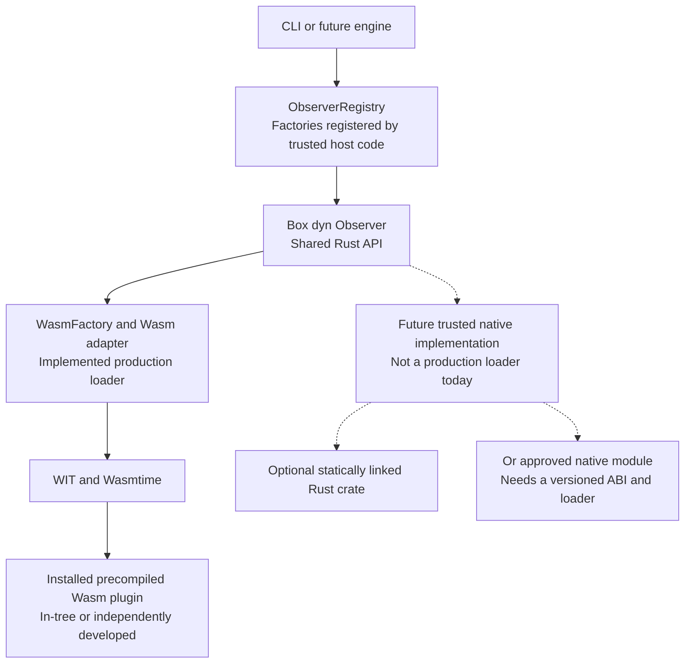
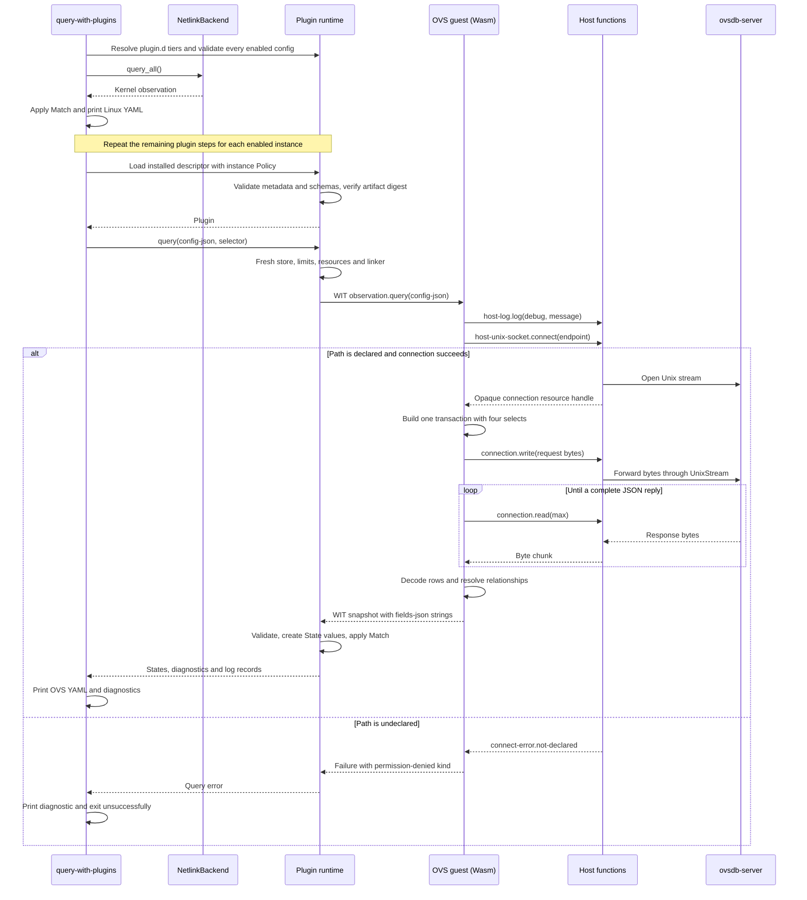
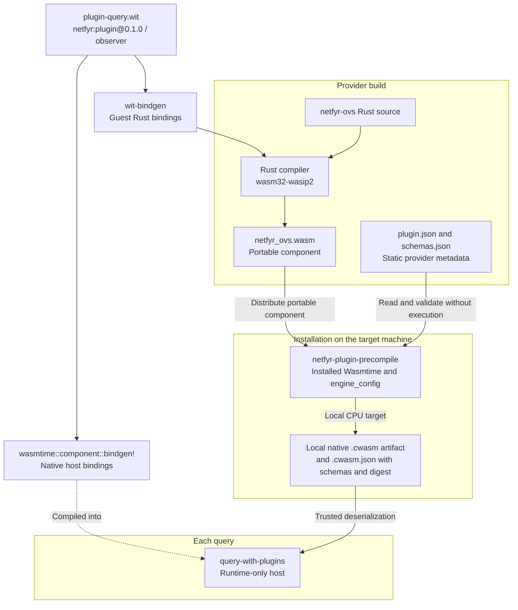

# OVS WebAssembly observer PoC — technical reference

[← Start with the short PoC overview](plugin-poc.md)

This document is the extended reference. Read individual sections as needed:

| Looking for… | Go to |
| --- | --- |
| Crates, source files and runtime structure | [Components](#components) |
| Rust traits, Wasm adapters and future native execution | [Observer contract](#observer-contract) |
| Operator settings, tier precedence and instance isolation | [Instance configuration](#instance-configuration) |
| Provider declarations, schemas and artifact integrity | [Plugin metadata](#plugin-metadata) |
| Calls crossing the WebAssembly boundary | [Query sequence](#query-sequence) |
| OVSDB tables, identities and ordering | [Observation shape](#observation-shape) |
| Execution limits and failures | [Execution and errors](#execution-and-errors) |
| Installation, system OVS and sandbox commands | [Build and run](#build-and-run) |
| Test commands and coverage | [Verification](#verification) |
| CPU, memory, timing methodology and raw results | [Measurements](#measurements) |

## Scope

This implements the executable experiment from the
[plugin-loading PoC plan](https://gist.github.com/qinqon/3ac11f9977c1c7e8c778b4898c04cc98),
based on netfyr revision `dd72ada`. The interface and packaging are experimental;
this is input to a plugin contract, not an implementation of the complete
[OVS discovery draft](https://md.netfyr.io/_pnXiNAzZO).

The packaging model is **portable `.wasm` from the provider, native precompilation
on the installation machine, and a runtime-only query executable**. The matching
netfyr precompiler handles the installed Wasmtime version, engine configuration
and local CPU target. The commands below model installation explicitly;
package-manager hooks and automatic artifact regeneration are follow-up work.

## Components

| Component | Responsibility |
| --- | --- |
| `crates/netfyr-plugin-api` | Wasmtime-independent observer/factory traits, registry, neutral types and shared configuration/result validation |
| `crates/netfyr-plugin-runtime` | Wasm execution adapter, explicit socket grants, logging, execution limits and WIT-to-neutral conversion |
| `crates/netfyr-plugin-runtime/wit/plugin-query.wit` | `netfyr:plugin@0.1.0` observer interface shared by host and guest |
| `crates/netfyr-ovs` | OVSDB protocol and topology decoder, built as an alloc-only WebAssembly component |
| `crates/netfyr-ovs/schemas.json` | Provider-owned schemas loaded before running the guest |
| `crates/netfyr-ovs/plugin.json` | Static provider identity, interface requirement and schema reference |
| `crates/netfyr-plugin-runtime/src/metadata.rs` | Descriptor validation and installed artifact/schema association |
| `crates/netfyr-plugin-runtime/src/instances.rs` | Tiered host configuration, per-instance schema validation and isolated execution |
| `crates/netfyr-ovs/examples/ovs-host.yaml` | Example operator drop-in, not implicitly enabled by installation |
| `query-with-plugins` example | Generic composition of kernel and explicitly configured plugin observations as query-form YAML documents |
| `crates/netfyr-plugin-precompile` | Compile portable components into trusted local native artifacts during installation/preparation |
| `fixtures/ovsdb` | Containerized upstream `ovs-sandbox` fixture |
| `tests/integration/plugins/overhead-probe` | Measurement-only native OVS reference, optional Wasm probe and Linux resource launcher; not a production plugin loader |

Wasmtime is pinned to **49.0.5**, and guest bindings to **wit-bindgen 0.63.0**.
The Wasm-specific PoC crates require Rust 1.96; the neutral observer API and
existing core crates retain the workspace's Rust 1.85 declaration. Building the
whole workspace therefore requires Rust 1.96 or newer.

### Runtime structure

In this PoC, `query-with-plugins` is the netfyr integration point: the example
queries the existing Linux backend and loads a locally precompiled OVS component
through the new runtime. The native host and WebAssembly guest execute in one
process; the fixture's `ovsdb-server` is an external service.



The state arrows show data flow; the example owns query ordering and calls the
YAML renderer for each source. OVS-specific protocol and topology logic live in
the guest, while the native host opens sockets. Shared validation lives in
`netfyr-plugin-api`, not in generated bindings. The instance runner creates a
`Box<dyn Observer>` through the registry and queries it without Wasmtime handles.
Explicit single-plugin development mode can still use `Plugin::load_package()`.

## Observer contract

The future engine-facing API is independent of the execution mechanism:

```rust
trait Observer {
    fn query(&mut self, config_json: &str, selector: &Match)
        -> Result<Snapshot, Error>;
    fn schemas(&self) -> Arc<SchemaRegistry>;
}
```

The actual trait, `ObserverFactory` and `ObserverRegistry` are in
`crates/netfyr-plugin-api/src/lib.rs`. This crate has no Wasmtime, WIT-generation,
dynamic-linking or OVS dependency. Its diagnostics, log levels, errors and
snapshots are ordinary Rust types. Generated component types remain private to
`netfyr-plugin-runtime`, which explicitly maps WIT records/enums into API types.
The Rust API is not the guest ABI; WIT remains the Wasm compatibility boundary.



`ValidatedObserver<B>` wraps an `ObserverBackend` and provides configuration
validation, observation schema checks, output budgets, conversion to `State`, and
selector matching. The Wasm adapter uses this wrapper; future native providers
can reuse it rather than implement a second validation pipeline. The backend
receives configuration only; host services and per-instance policy are bound
when its factory constructs it. No Wasmtime store/resource appears in the
engine-facing interface. A custom trusted implementation must still honor the
trait's behavioral contract; the trait alone does not enforce it.

The only production factory remains `WasmFactory`. Its registration requires a
trusted installation; the registry rejects duplicate identities and cannot load
native modules or arbitrary library paths. The `plugin.d` files still select
installed plugin identities and need no execution-mechanism option.

`netfyr-plugin-api/src/tests.rs` contains a **test-only native fixture**, linked
normally by Rust. It implements `ObserverBackend` and uses the same validated
wrapper and object-safe registry as the Wasm path. Tests cover schemas, matching,
errors, diagnostics/logs, config rejection before execution and per-instance
policy construction, without building or depending on Wasmtime. The existing
component tests exercise the production Wasm adapter through that same wrapper.
The fixture does not establish a native sandbox or serve as a native OVS plugin.

Future native execution is intentionally deferred:

- An in-tree crate compiled into netfyr could directly implement the Rust
  contract and be optional at build time.
- A plugin shipped separately as a native shared library would additionally need
  trusted registration, compatibility checks and a versioned native ABI. Ordinary
  Rust trait objects must not cross a dynamic-library ABI boundary.
- Native code would share host memory and privileges. It could bypass service
  wrappers, block indefinitely or crash the process; Wasm fuel, memory limits,
  trap containment and epoch interruption are not promises of the common trait.

For now, all loadable plugins remain Wasm components, including plugins whose
source is in-tree, precompiled into local machine code during installation. A
native loader would be a separate feature justified by a real requirement.

### Configuration and capability boundary

The WIT query accepts an opaque `config-json` string, adding configuration to the
gist's sketch. The generic example passes it unchanged (default `{}`). Plugin
identity and schemas come from installed metadata, not manual `--schemas` or
`--source` arguments. It has no provider-specific flags, schema paths,
configuration parsing or socket defaults.

The OVS guest interprets `{"endpoint":"/path/to/db.sock"}` and owns the default
`/run/openvswitch/db.sock` when the endpoint is omitted. Its package supplies
`crates/netfyr-ovs/schemas.json`; its connection/protocol failures include the
endpoint. The host independently grants literal socket paths in `Policy` using
`--allow-socket`; **no socket is granted by default**, even when a plugin's
configuration requests one. The example reads tiered instance drop-ins by
default; explicit descriptor arguments remain a single-plugin development mode.
This is not yet the official netfyr CLI.

## Instance configuration

Operator configuration is separate from provider metadata and observation state.
The host reads instance files from these tiers, low to high:

| Directory | Purpose |
| --- | --- |
| `/usr/lib/netfyr/plugin.d/` | Package defaults |
| `/etc/netfyr/plugin.d/` | Administrator configuration |
| `/run/netfyr/plugin.d/` | Ephemeral runtime overrides |

For example, `/etc/netfyr/plugin.d/ovs-host.yaml`:

```yaml
plugin: ovs
enabled: true
config:
  endpoint: /custom/openvswitch/db.sock
grants:
  unix-sockets:
    - /custom/openvswitch/db.sock
timeout-ms: 5000
```

The filename stem (`ovs-host`) is the instance identity. `plugin: ovs` selects
`/usr/lib/netfyr/plugins/ovs.cwasm.json`, whose embedded `id` must also be `ovs`.
The plugin directory and installed artifacts must contain trusted precompiler
output. Configuration files control native plugin selection and socket grants,
so these directories must only be writable by authorized operators. Explicit
development directory options likewise designate trusted locations; they are not
an interface for executing arbitrary untrusted precompiled packages.

Rules for this experimental loader:

- Higher tiers replace the **whole file by instance name**, never deep-merge
  settings or union grants. `host.yml` and `host.yaml` identify the same instance;
  both in one tier are an error. Missing directories are allowed, other I/O
  failures are errors. Hidden/non-YAML files are ignored.
- Winning YAML files are parsed only after tier resolution. A higher-tier
  `enabled: false` file can disable an instance without naming a plugin, opening
  its descriptor, or parsing a shadowed lower-tier file. Symlinks and directories
  masquerading as YAML files are rejected; use `enabled: false`, not `/dev/null`
  symlinks, to disable an instance.
- Instances execute in lexicographic name order. One plugin can have multiple
  instances; each has its own config, socket grants, store, resources and limits.
  Another instance's grant never grants this instance access.
- `enabled` defaults to true, `config` to `{}`, grants to none and `timeout-ms`
  to 5000 (allowed range 1–60000). Drop-ins are at most 64 KiB. Control fields
  reject typos; plugin config rejects unknown fields/types using the provider's
  embedded configuration schema. Defaults inside plugin config are interpreted
  by the guest, not applied by the schema validator.
- All enabled configs and metadata are validated **before any guest executes**.
  Configuration errors fail preflight. Execution failures remain per-instance:
  successful observations are printed and later instances still run, but the
  example exits unsuccessfully if any instance fails.
- Drop-ins are reread on each invocation. No daemon or reload command is needed.
  There is no global JSON/config/grant override in directory mode: per-instance
  values come from the selected files.

`instances::load()` and `instances::prepare()` are reusable, non-executing Rust
APIs. `observer_registry()` registers trusted Wasm factories without execution;
`PreparedInstance::query(&registry, selector)` creates an observer through the
neutral registry and executes with that instance's host policy. The
example handles stdout/stderr and preserves instance/plugin labels, leaving a
path for the future engine and CLI without adding OVS branches to either.

## Plugin metadata

Providers ship a portable component, a static descriptor and a schema file.
For OVS, `crates/netfyr-ovs/plugin.json` contains:

```json
{
  "format-version": 1,
  "id": "ovs",
  "interface": "netfyr:plugin/observer@0.1.0",
  "schemas-file": "schemas.json",
  "config-schema": {
    "type": "object",
    "additionalProperties": false,
    "properties": { "endpoint": { "type": "string" } }
  }
}
```

The schema path is relative to the provider descriptor, not the query process's
working directory. The descriptor identifies the required WIT world; Wasmtime
also checks the actual component imports/exports at instantiation. Reading
metadata never invokes a guest `describe()` API.

The precompiler validates the descriptor and schemas before compiling. Alongside
`netfyr-ovs.cwasm`, it creates `netfyr-ovs.cwasm.json`, embedding the schemas and
recording identity, metadata version, interface, configuration schema, sibling
artifact filename and artifact SHA-256. `Plugin::load_package()` validates that metadata and registers
the schemas, then verifies and deserializes the exact artifact bytes it read.
The installed pair can be relocated without the provider schema file.

This detects changed artifacts or accidental descriptor mismatches. **It is not
authentication:** replacing both files also allows replacing the digest. Both
files and their directory must remain trusted. The descriptor data is written
after the artifact data; interrupted installs can leave incomplete files, which
the loader rejects. Retry with fresh output paths. Metadata/schema files are
limited to 4 MiB each; incompatible format/interface requirements, unsafe paths
and invalid schemas are rejected before execution. Unknown descriptive
extensions are ignored.

This minimal PoC descriptor is not the complete P3 manifest contract. It does not
yet describe defaults, capability requirements or metrics, verify signatures,
or validate every schema keyword beyond the existing registry's dialect.
The configuration schema must describe an object and is required: regenerate
older installed descriptors before using this version. Socket grants remain independent host policy;
schema ownership confers no I/O privileges. The final package lifecycle and
manifest still need a reviewed contract.

Each returned `fields-json` object contains exactly one sub-object named after
its declared device type. The host supplies the name and match metadata, rejects
undeclared types, duplicate `(type, name)` identities and invalid values, then
validates with `SchemaRegistry::add_schema_node()` and `validate()`.

The guest has **no WASI imports**: socket I/O and logging use only the two WIT host
interfaces. `no_std` with `alloc`, a linear-memory allocator and a canonical ABI
`cabi_realloc` export keep Rust's ambient WASI dependencies out of the component.
The target's static C library supplies only referenced memory routines such as
`memcpy` and `memcmp`.

The socket capability restricts endpoints, **not OVSDB operations**. The OVS
guest issues a select-only transaction, and tests verify an unchanged database.
Enforced read-only access against a guest that deliberately sends modifying
operations would require server-side read-only authorization or a narrower host
capability. Socket paths and their containing directories are trusted host
configuration; this PoC does not resolve paths into symlink-safe capabilities.

## Query sequence

The sequence below follows the example's default query, including the Linux
observation, and shows both successful discovery and rejection of an undeclared
socket. Guest calls to host functions are callbacks into the same process.



WIT bindings translate the typed call and snapshot through the Component Model's
Canonical ABI. The `fields-json` strings are then decoded and schema-validated by
the host before becoming `State` values. A trap, deadline, guest failure or
invalid result is reported as an error; the Linux YAML has already been printed.

## Observation shape

One RFC 7047 transaction selects these columns from `Open_vSwitch`:

| Table | Columns |
| --- | --- |
| `Open_vSwitch` | `_uuid`, `bridges` |
| `Bridge` | `_uuid`, `name`, `ports`, `datapath_type` |
| `Port` | `_uuid`, `name`, `interfaces` |
| `Interface` | `_uuid`, `name`, `type` |

The PoC reports one device per row, including an experimental `ovs_database`
device for the root row. The other types are `ovs_bridge`, `ovs_port` and
`ovs_interface`. UUIDs stay in their type-specific sub-objects. Relationships use
names, lists are sorted, and ambiguous parents produce diagnostics rather than
an arbitrary choice. Empty interface/datapath type strings normalize to `system`.

Devices are ordered by database, bridge, port, interface, then name. Maps have
sorted keys. The root-row device and all-row reporting follow the PoC, while the
discovery draft's final reachable-row inventory and status model remain future
work. Metadata columns (`options`, `external_ids`, `other_config`) are not selected
in this topology-only slice; their redaction rules can be implemented together.

The host uses `Source::Kernel`, the existing observed-state source, and
`Match::matches()` for selection. It creates no kernel namespace/ifindex identities
for OVS rows. The example prints the kernel namespace and caller-supplied source
label with their respective YAML documents. OVS results never enter the backend
registry or the reconciliation inventory in this example.

## Execution and errors

Each query gets a fresh store and resource table. The default query deadline is
five seconds, covering instantiation and execution, with the same absolute
deadline used for socket connect/read/write. An epoch interrupt bounds CPU-bound
guests, and a separate fuel budget limits instruction execution. Loading the
precompiled component occurs before that query deadline.

The host also limits linear memory (64 MiB per memory, at most four memories),
connections (four attempts), total socket I/O (8 MiB), individual reads (64 KiB),
and log records (128, at most 4 KiB each). Result validation accepts at most 4096
devices, 256 diagnostics and 4 MiB of field JSON. Result limits are checked after
WIT lifting; they are not a general bound on all host allocations.

Failures return errors rather than an empty topology. The example prints the
kernel observation first, so an OVS failure remains visible alongside that data,
and exits unsuccessfully with a source-labelled diagnostic. OVS guest connection
and protocol errors supply their own endpoint context; host-generated errors
such as traps and deadlines remain technology-independent. The full
`auto`/`required`/`disabled` discovery status contract is not part of this PoC.

## Build and run

### From source to a loaded component

Both sides generate bindings from the same WIT world at build time. The provider
builds the portable component. Installation runs the matching native precompiler
on the target machine. At query time, the runtime-only host loads that artifact
and supplies the imported functions when instantiating it:



The query host uses `netfyr-plugin-runtime`, which is runtime-only by default.
Precompilation lives in the separate build/install tool. Build them in separate
Cargo invocations so workspace feature unification cannot include the compiler
in the query executable.

### Provider: build the portable component

Run commands from the repository root:

```bash
rustup target add wasm32-wasip2
cargo build --locked --release -p netfyr-ovs \
  --target wasm32-wasip2 --target-dir target/guest
```

### Build the native PoC tools

In a packaged installation, netfyr supplies these as prebuilt native executables.
Building them here is PoC setup; the installation step itself only runs the
precompiler over the provider's WebAssembly component.

```bash
cargo build --locked --release -p netfyr-plugin-precompile \
  --target-dir target/plugin-tools
cargo build --locked --release -p netfyr-plugin-runtime --no-default-features \
  --example query-with-plugins --target-dir target/plugin-native
```

### Installation: precompile for this machine

```bash
mkdir -p target/plugin-artifacts
target/plugin-tools/release/netfyr-plugin-precompile \
  target/guest/wasm32-wasip2/release/netfyr_ovs.wasm \
  --metadata crates/netfyr-ovs/plugin.json \
  --output target/plugin-artifacts/ovs.cwasm
```

Keep the portable `.wasm` as the distributable input and treat `.cwasm` as a
rebuildable local artifact. Regenerate it when the plugin changes, after an
incompatible Wasmtime/engine-configuration change, or when moving to an
incompatible CPU target. This lets a netfyr runtime upgrade recompile installed
plugins without requiring providers to publish runtime-specific native builds.
The precompiler refuses to overwrite an existing file; use a fresh output path
when rebuilding.

### Run configured instances (normal mode)

On an installed system with trusted plugin artifacts in
`/usr/lib/netfyr/plugins/` and administrator drop-ins in
`/etc/netfyr/plugin.d/`, the example needs no plugin/config arguments:

```bash
target/plugin-native/release/examples/query-with-plugins
```

To try the same loader locally without modifying system directories:

```bash
mkdir -p target/plugin-demo/plugin.d
cp crates/netfyr-ovs/examples/ovs-host.yaml target/plugin-demo/plugin.d/
target/plugin-native/release/examples/query-with-plugins \
  --plugin-dir target/plugin-artifacts \
  --plugin-config-dir target/plugin-demo/plugin.d \
  --no-kernel
```

Socket permissions may require running the trusted host executable as an
authorized user or via `sudo`. This does not bypass host grants. Edit the local
drop-in's endpoint and grant to use a different socket. Use a second file for a
second instance; changing operator config never requires recompiling the plugin.

Repeat `--plugin-config-dir` for explicit low-to-high tiers. Supplying any such
option replaces the standard tiers; `--plugin-dir` overrides the installed
artifact directory. Directory options cannot be combined with explicit
single-plugin component paths, config, grants or timeout arguments.

### Explicit single-plugin development mode

```bash
target/plugin-native/release/examples/query-with-plugins \
  --trusted-precompiled target/plugin-artifacts/ovs.cwasm.json \
  --allow-socket /run/openvswitch/db.sock
```

`--trusted-precompiled` selects Wasmtime's unsafe deserialization path. It does
not authenticate the files: use unmodified descriptor and artifact output from
the trusted local precompilation step and protect their directory.

Useful example options:

- `--name br0` selects every OVS type named `br0`; `--type ovs_bridge` selects bridges.
- `--no-kernel` prints only the plugin observation.
- `--trusted-precompiled PATH` selects the installed descriptor; its identity
  labels output and its embedded schemas validate observations.
- `--config-json JSON` passes opaque configuration to the guest (default `{}`).
  For this OVS plugin, override the endpoint with `{"endpoint":"/path/to/db.sock"}`.
- `--allow-socket PATH` grants exactly that socket path; repeat for multiple
  grants. Configuration does not grant access, and no grant is added implicitly.
- `--timeout-ms N` sets a query deadline in `(0, 60000]` milliseconds.

### Private ovs-sandbox fixture

```bash
repo_root="$PWD"
source tests/integration/plugins/lib/fixture.sh
trap ovs_fixture_cleanup EXIT
ovs_fixture_start

target/plugin-native/release/examples/query-with-plugins \
  --trusted-precompiled target/plugin-artifacts/ovs.cwasm.json \
  --config-json "{\"endpoint\":\"$ovs_fixture_dir/sandbox/db.sock\"}" \
  --allow-socket "$ovs_fixture_dir/sandbox/db.sock"
```

The helper builds a Debian 12/Open vSwitch 3.1 image and verifies the checksum of
the upstream `ovs-sandbox` script. It runs the sandbox in a fresh bind-mounted
directory in a rootless-capable container with no network or added capabilities.
The sandbox starts OVS in dummy mode. Its nested fixture shell stops the dummy
`ovs-vswitchd`, then populates the database with `ovs-vsctl --no-wait`. This tests
discovery with only `ovsdb-server` running and makes before/after dumps stable.

Set `CONTAINER_ENGINE=docker` to use Docker, or `NETFYR_OVS_IMAGE` to reuse an
already-built compatible fixture image. Cleanup removes only the fixture's
container and temporary directory. Missing prerequisites fail the tests.

### Compile-on-load measurement baseline

The `compile` feature is opt-in for comparing the cost of compiling on every
query with installation-time precompilation. It enables the example's `--plugin`
option for portable components:

```bash
cargo run --locked --release -p netfyr-plugin-runtime --features compile \
  --example query-with-plugins --target-dir target/plugin-compile -- \
  --plugin target/guest/wasm32-wasip2/release/netfyr_ovs.wasm \
  --metadata crates/netfyr-ovs/plugin.json \
  --config-json "{\"endpoint\":\"$ovs_fixture_dir/sandbox/db.sock\"}" \
  --allow-socket "$ovs_fixture_dir/sandbox/db.sock"
```

## Verification

```bash
cargo test --workspace --all-targets
make clippy
cargo clippy --locked --release -p netfyr-ovs -p netfyr-plugin-test-guest \
  --target wasm32-wasip2 --target-dir target/guest -- -D warnings
make test
make test-plugins
make docs
```

Native unit tests cover JSON-RPC stream fragmentation and echo handling,
select-only requests, canonical ordering, UUID/reference validation, ambiguous
parents, OVS-owned endpoint configuration and host schema enforcement. The shell
component tests precompile the guests and run a separately built runtime-only
host. They compare names and UUIDs
to `ovs-vsctl`, compare database dumps, and exercise denied/missing/refused sockets,
traps, invalid output, incompatible interfaces and CPU/I/O deadlines. They also
check that the runtime-only executable rejects compilation on load.
An unrelated fixture observer with its own schemas also runs without OVS
configuration or socket grants, exercising the generic composition path.
Metadata tests cover incompatible versions/interfaces, invalid schemas, unsafe
paths, missing or digest-mismatched artifacts and relocation of the installed
pair without provider schema files.
The neutral API's native fixture tests run separately with
`cargo test -p netfyr-plugin-api`; `cargo tree -p netfyr-plugin-api` verifies its
dependency graph contains no Wasmtime/WIT tooling. No native loader is enabled.
Instance tests cover tier precedence, whole-file replacement, disabled overrides,
preflight schema errors, stable ordering, partial failures and same-provider
grant isolation against the real OVSDB fixture. Two providers also use an
`endpoint` config field with different values, proving configuration is scoped
to the instance rather than shared globally.
The real-server fixture is tested with Open vSwitch 3.1.0 on Debian 12; this is
not yet a multi-version support matrix.

## Measurements

In the packaging measurements below, "precompiled native" means a **Wasm
component compiled into native machine code**, not a Rust native plugin. The
separate overhead comparison uses a measurement-only native OVS reference, not a
production native plugin or loader.

### Measuring Wasm overhead against equivalent native discovery

```bash
scripts/measure-wasm-overhead.sh
```

This compares the same `netfyr-ovs` endpoint parser, transaction builder and
topology decoder compiled natively and as the existing precompiled Wasm guest.
Both paths use `ValidatedObserver`, the same observation/config schemas and the
same private 11-row database. The native reference mirrors the host's Tokio Unix
socket calls, absolute I/O deadlines, 16 KiB reads and total I/O budget. It is
benchmark code under `tests/integration/plugins/overhead-probe`, not a new native
plugin mechanism. YAML is compared byte-for-byte before measurements begin.

Two binaries are built separately: the native reference has no Wasmtime
dependency, and the Wasm build excludes the native reference implementation.
Both use release optimization and stripped symbols, without LTO. Both query OVS
only: there is no Linux inventory, plugin.d scan or YAML rendering in the timed
loop. The precompiler and database server are outside the measured process.

The modes separate different costs:

- **One-shot:** a fresh process loads its observer, executes one query, emits a
  small JSON timing record and exits. This includes process startup and setup.
  Wasm setup includes the actual production descriptor/schema validation,
  artifact hashing, Wasmtime engine creation and artifact deserialization. The
  statically linked native reference reads the same embedded schemas but has no
  artifact to hash or deserialize. Thus the difference measures the practical
  current adapter/loading path, not just generated instruction overhead.
- **Warm:** a fresh process loads the observer once, runs five warmup queries,
  then times 100 queries. The Wasm adapter still creates a fresh store, host I/O
  runtime and deadline watchdog per query, as production does. The native
  reference also opens a new connection and I/O runtime per query. The query
  timer includes shared validation and result construction, but excludes setup
  and JSON timing-record output.

There are three discarded process warmups followed by 30 measured processes per
variant per mode. Native/Wasm pair order alternates to reduce drift. Warm query
latency is the median of each process's median over its 100 measured queries.
Override with `NETFYR_OVERHEAD_SAMPLES` and `NETFYR_OVERHEAD_WARM_QUERIES`.

The small native `resource-probe` launcher uses Linux `wait4` for each child's
user/system CPU times and peak RSS. Its small pre-exec address space avoids a
large Python supervisor setting the child's RSS floor. CPU time is user plus
system milliseconds across client threads, not CPU utilization percent; it
excludes the OVS server. RSS is resident process memory, not heap allocation,
virtual address reservations, or a per-plugin memory guarantee. Batch CPU/RSS
figures include setup and all 105 queries, even though only the last 100 query
latencies are retained. The wrapper's own CPU/RSS is not counted.

Raw per-process resources, internal query timings, matching YAML and dependency
evidence are retained under `target/wasm-overhead/artifacts.*/`. These are
warm-filesystem, sequential local measurements of a small topology, not
cold-cache, compute-only, concurrent or large-host benchmarks. No native safety
or crash isolation is implied by the reference.

#### Overhead results — 17 November 2026

Intel Core i7-10850H, Fedora/Linux x86_64, Rust 1.96.1, Wasmtime 49.0.5,
Open vSwitch 3.1.0; 30 measured processes per variant/mode. The two paths returned
identical YAML for all 11 database rows.

Fresh process, one OVS query (medians):

| Metric | Native Rust reference | Precompiled Wasm | Wasm minus native |
| --- | ---: | ---: | ---: |
| Process wall time | 1.213 ms | 6.283 ms | +5.070 ms |
| Client CPU time (user + system) | 1.043 ms | 6.165 ms | +5.122 ms |
| Peak resident memory | 2.85 MiB | 5.36 MiB | +2.51 MiB |
| Observer setup inside the process | 0.156 ms | 4.709 ms | +4.553 ms |
| First query, excluding setup | 0.336 ms | 0.655 ms | +0.318 ms |

Already-loaded observer, five warmup queries then 100 measured queries per
process (medians):

| Metric | Native Rust reference | Precompiled Wasm |
| --- | ---: | ---: |
| Query wall time, excluding setup | 0.195 ms | 0.405 ms |
| Complete batch process wall time | 22.865 ms | 49.704 ms |
| Complete batch client CPU time | 16.699 ms | 46.490 ms |
| Batch process peak RSS | 2.97 MiB | 5.36 MiB |

For this small fixture, the current Wasm path adds roughly **5 ms CPU/wall time
and 2.5 MiB peak RSS** to a one-shot OVS-only process. Most extra one-shot wall
time appears in setup. After loading, the measured query adds about **0.210 ms**
(approximately 2.1 times the native reference's query latency). This is not a
universal Wasm execution multiplier: it includes the current adapter, host calls,
fresh-store and deadline-watchdog costs, as well as native-compiled guest code.
The batch CPU numbers above are totals, not per-query CPU measurements.

The two stripped probes are 1,186,624 bytes (native) and 2,349,656 bytes (Wasm),
with a separate 765,080-byte precompiled component. These are OVS-only benchmark
executables, not the full `query-with-plugins` binary. Peak RSS is for one
process; do not extrapolate it as a fixed allocation for each plugin in a larger
engine. Provider/native code provenance checks also differ: native code is
linked into the benchmark, while the Wasm path validates installed metadata and
the artifact digest at load time.

Raw samples and correctness outputs:
`target/wasm-overhead/artifacts.ZwLf2l/overhead.json` and the adjacent YAML files.
The recorded revision is `2907252` plus the uncommitted benchmark changes.

### Packaging and compile-on-load comparison

```bash
scripts/measure-plugins.sh
```

This builds the kernel baseline, compile-on-load comparison, runtime-only native
host and install-time precompiler in separate Cargo invocations and target
directories. It verifies identical plugin YAML between compilation on load and
native precompiled execution, and checks the actual runtime-only build artifacts
for compiler packages. All host builds use release optimization and stripped
symbols, without LTO tuning. Compile-on-load enables the minimal Cranelift feature
set, rather than all of Wasmtime's default features.

The reported crate count is the number of unique package IDs emitted as
`compiler-artifact` messages, including build dependencies and the selected
workspace packages. Runtime-only builds still need WIT/parser tooling at build
time, and small `cranelift-*` utility crates can be runtime dependencies without
including the Cranelift compiler.

Timing measures process start through exit, including Linux discovery, plugin
load/compilation, OVSDB query, validation and YAML rendering. The baseline queries
Linux only. The fixture starts outside the timed interval. Each variant has three
warmups followed by 20 samples (override with `NETFYR_MEASURE_ITERATIONS`). These
are warm-filesystem, one-shot measurements, not cold-cache or throughput tests.
The comparison uses explicit single-plugin development mode; it does not measure
tier scanning or multiple-instance orchestration. Both plugin paths validate the
provider's config schema; precompiled loading also checks the artifact digest.

The script separately records the duration of one native precompilation process
and the precompiler binary size. That preparation cost is paid once per artifact,
outside the query measurements. The query benchmark compares precompilation
with compilation on load; it does not compare local and provider-side compilation
of equivalent native artifacts.

Raw samples, build package records, feature trees and guest artifacts are saved
under the Cargo target directory's `plugin-measurements/artifacts.*` directory.

### Recorded results — 17 November 2026

Measured on an Intel Core i7-10850H, Linux x86_64
(`7.2.11-200.fc44`, glibc 2.43), Rust 1.96.1, Wasmtime 49.0.5 and the
Open vSwitch 3.1.0 sandbox fixture. The fixture contains 11 OVSDB rows. Each result
below uses three warmups and 20 measured, separate process invocations.

| Variant | Wasmtime features | Stripped binary (bytes) | Packages built | Median query (ms) | Min–max (ms) |
| --- | --- | ---: | ---: | ---: | ---: |
| Kernel baseline | none | 2,955,088 | 59 | 7.03 | 6.77–10.26 |
| Compile component on load | `std`, `runtime`, `component-model`, `cranelift` | 16,974,872 | 138 | 375.14 | 368.95–412.43 |
| Precompiled native | `std`, `runtime`, `component-model` | 4,712,984 | 116 | 12.57 | 12.21–13.32 |

The one-time native precompilation and descriptor generation took **376.97 ms**
in a single process invocation. The stripped precompiler binary is
**13,346,064 bytes**, separate from
the query executable. Keeping that tool installed adds to the total installation
footprint; the table above measures the query executable only.

The portable guest is **238,349 bytes** and the native artifact is **765,080 bytes**.
These artifacts are additional to the host binary sizes above. The portable
guest's SHA-256 for this run is
`6b7a77deaf15df959b25c0a9d2e8e34337e013faeffbbeb9da0c5d840e30534f`.

The compile-on-load and precompiled executions returned identical YAML. The
runtime-only build records and feature tree exclude the Cranelift and Winch
compiler packages. Relative to the kernel baseline, the native host adds about
**1.76 MB** of binary size and **5.54 ms** of median end-to-end time for this
fixture. The build still needs 57 additional packages, including the
binding-generation toolchain.

The raw local run is retained at
`target/plugin-measurements/artifacts.rHDRyQ/measurements.json`, alongside the
Cargo build records, resolved features, precompiled components and compared YAML.
