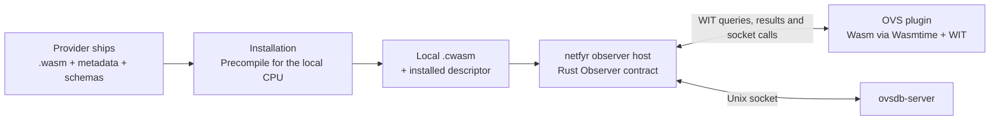

# OVS WebAssembly plugin PoC

**Goal:** discover OVS topology through a separately shipped plugin, without
putting OVS logic in netfyr core or requiring a netfyr daemon.

**Status:** working experiment, not the final plugin specification or official
CLI. WebAssembly is the only production loader; a neutral Rust observer contract
leaves room for trusted native implementations later.

[Run it](#try-it) · [Measured overhead](#what-does-wasm-cost) ·
[Code reading map](#where-to-read-the-code) ·
**[Extended technical reference](plugin-poc-reference.md)**

## How it fits together



Host and guest run in one process; `ovsdb-server` is external.

- **Plugin:** owns endpoint settings, OVSDB reads, topology decoding and schemas.
- **Host:** reads `plugin.d` instances, validates data and enforces socket grants.
- **Query:** uses one transaction with four `select` operations for a consistent
  snapshot of the database, bridges, ports and interfaces.
- **Output:** Linux and OVS observations remain separate; OVS rows keep their UUIDs
  and never enter the reconciliation inventory.

> **Trust boundary:** socket grants restrict endpoints, not OVSDB operations.
> Read-only behavior is implemented by this guest. Installed descriptors and
> precompiled artifacts must be trusted; their SHA-256 association is not a signature.

## What does Wasm cost?

Measured **17 November 2026** on an i7-10850H/Linux x86_64, Wasmtime 49.0.5,
Rust 1.96.1 and OVS 3.1.0. Same discovery code, schemas and 11-row database;
identical YAML output. Values are medians from 30 processes per variant.

### Native reference vs precompiled Wasm

| Fresh process, one OVS query | Native Rust reference | Precompiled Wasm | Difference |
| --- | ---: | ---: | ---: |
| Wall time | 1.213 ms | 6.283 ms | **+5.070 ms** |
| Client CPU time | 1.043 ms | 6.165 ms | **+5.122 ms** |
| Peak resident memory | 2.85 MiB | 5.36 MiB | **+2.51 MiB** |

**Already loaded:** median query latency was **0.195 ms native vs 0.405 ms Wasm**
(+0.210 ms), after five warmups and 100 measured queries per process. Most extra
one-shot time was in setup: 0.156 ms native vs 4.709 ms Wasm.

These are **OVS-only probe measurements**, excluding Linux inventory, timed YAML
rendering and server CPU. CPU is user + system time, not utilization percent.
RSS is process memory, not a fixed allocation per plugin. This small, warm-cache
fixture is not a universal Wasm slowdown estimate. The native reference is
benchmark-only—not a production native loader.

### Why precompile during installation?

| Full query example | Stripped host binary | Median process time |
| --- | ---: | ---: |
| Compile Wasm on every invocation | 16.97 MB | 375.14 ms |
| Load locally precompiled Wasm | **4.71 MB** | **12.57 ms** |

Unlike the OVS-only comparison above, these timings include Linux discovery and
YAML output and use 20 measured processes per variant. One-time precompilation
took **376.97 ms**. The precompiler is a
separate **13.35 MB** tool; the portable guest is 238 kB and its compiled artifact
765 kB. A smaller query binary does not imply a smaller total installation.

Reproduce with `scripts/measure-wasm-overhead.sh` and `scripts/measure-plugins.sh`.
See [measurement methods, complete tables and raw-data paths](plugin-poc-reference.md#measurements).

## Try it

Run in **Bash from the repository root**. Requires Rust 1.96+.
For the sandbox/tests, also install Podman (or Docker) and Python PyYAML.

### 1. Build the guest and tools

Build the precompiler and host separately to keep the compiler out of the host:

```bash
rustup target add wasm32-wasip2
cargo build --locked --release -p netfyr-ovs \
  --target wasm32-wasip2 --target-dir target/guest
cargo build --locked --release -p netfyr-plugin-precompile \
  --target-dir target/plugin-tools
cargo build --locked --release -p netfyr-plugin-runtime --no-default-features \
  --example query-with-plugins --target-dir target/plugin-native
```

### 2. Precompile locally — the installation step

Use a fresh directory: the precompiler refuses to overwrite existing files.
No package-manager hooks or system installation are performed here.

```bash
mkdir -p target/plugin-demo
demo="$(mktemp -d "$PWD/target/plugin-demo/run.XXXXXX")"
mkdir "$demo/plugins" "$demo/plugin.d"
target/plugin-tools/release/netfyr-plugin-precompile \
  target/guest/wasm32-wasip2/release/netfyr_ovs.wasm \
  --metadata crates/netfyr-ovs/plugin.json \
  --output "$demo/plugins/ovs.cwasm"
cp crates/netfyr-ovs/examples/ovs-host.yaml "$demo/plugin.d/"
```

### 3. Query your existing OVS installation

The example drop-in targets `/run/openvswitch/db.sock`. OVS must be running.
If needed, edit **both** `config.endpoint` and `grants.unix-sockets` in
`"$demo/plugin.d/ovs-host.yaml"` to point at another socket. No recompile is needed.

```bash
target/plugin-native/release/examples/query-with-plugins \
  --plugin-dir "$demo/plugins" --plugin-config-dir "$demo/plugin.d" \
  --no-kernel
```

Socket permissions may require `sudo` on that **trusted local executable**.
Remove `--no-kernel` to include Linux interfaces; add `--type ovs_bridge` to select
bridges. Installed configuration tiers are `/usr/lib/netfyr/plugin.d` →
`/etc/netfyr/plugin.d` → `/run/netfyr/plugin.d` (last wins).

Prefer an isolated database? Run **`make test-plugins`** for the automated sandbox
suite, or follow the [manual sandbox instructions](plugin-poc-reference.md#private-ovs-sandbox-fixture).

## Where to read the code

| Question | Start here |
| --- | --- |
| What does the engine call? | [`netfyr-plugin-api/src/lib.rs`](../crates/netfyr-plugin-api/src/lib.rs) |
| How are schemas and results checked? | [`netfyr-plugin-api/src/validation.rs`](../crates/netfyr-plugin-api/src/validation.rs) |
| What crosses the Wasm boundary? | [`plugin-query.wit`](../crates/netfyr-plugin-runtime/wit/plugin-query.wit) |
| How does Wasm execute? | [`netfyr-plugin-runtime/src/lib.rs`](../crates/netfyr-plugin-runtime/src/lib.rs) |
| How does plugin.d work? | [`instances.rs`](../crates/netfyr-plugin-runtime/src/instances.rs) |
| What does OVS discovery do? | [`protocol.rs`](../crates/netfyr-ovs/src/protocol.rs), then [`topology.rs`](../crates/netfyr-ovs/src/topology.rs) |

## What is still experimental?

- The descriptor/configuration formats and official CLI/engine integration.
- Package install/upgrade hooks and automatic artifact regeneration.
- Full OVS discovery status, reachable-row filtering and metadata/redaction.
- Native plugin loading. Only a test fixture and benchmark reference exist.

For deeper reading: **[architecture, diagrams, configuration, trust limits,
testing and benchmark methodology](plugin-poc-reference.md)**.
Original context: [PoC gist](https://gist.github.com/qinqon/3ac11f9977c1c7e8c778b4898c04cc98)
and [OVS discovery draft](https://md.netfyr.io/_pnXiNAzZO).
