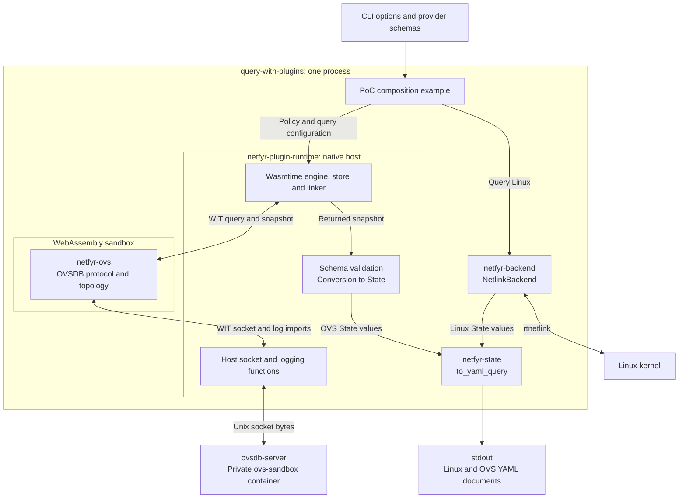
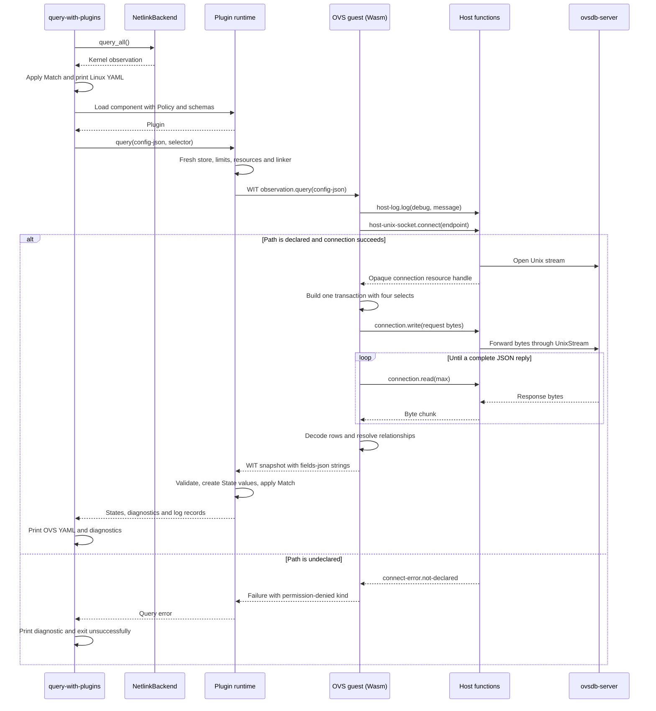
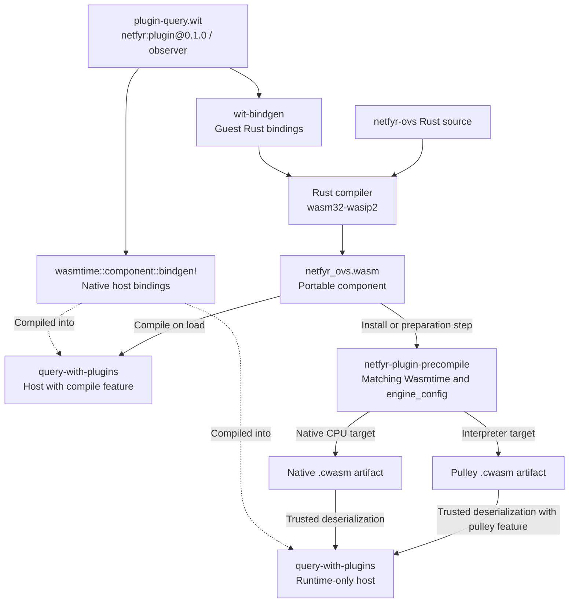

# OVS WebAssembly observer PoC

This implements the executable experiment from the
[plugin-loading PoC plan](https://gist.github.com/qinqon/3ac11f9977c1c7e8c778b4898c04cc98),
based on netfyr revision `dd72ada`. The interface and packaging are experimental;
this is input to a plugin contract, not an implementation of the complete
[OVS discovery draft](https://md.netfyr.io/_pnXiNAzZO).

## Components

| Component | Responsibility |
| --- | --- |
| `crates/netfyr-plugin-runtime` | Wasmtime host, explicit socket grants, logging, execution limits, schema validation and conversion to `State` |
| `crates/netfyr-plugin-runtime/wit/plugin-query.wit` | `netfyr:plugin@0.1.0` observer interface shared by host and guest |
| `crates/netfyr-ovs` | OVSDB protocol and topology decoder, built as an alloc-only WebAssembly component |
| `crates/netfyr-ovs/schemas.json` | Provider-owned schemas loaded before running the guest |
| `query-with-plugins` example | Compose kernel and plugin observations as query-form YAML documents |
| `crates/netfyr-plugin-precompile` | Compile portable components into trusted local native or Pulley artifacts |
| `fixtures/ovsdb` | Containerized upstream `ovs-sandbox` fixture |

Wasmtime is pinned to **49.0.5**, and guest bindings to **wit-bindgen 0.63.0**.
The PoC crates require Rust 1.96; existing core crates retain their own Rust 1.85
declaration. Building the whole workspace therefore requires Rust 1.96 or newer.

### Runtime structure

In this PoC, `query-with-plugins` is the netfyr integration point: the example
queries the existing Linux backend and explicitly loads an OVS component through
the new runtime. The native host and WebAssembly guest execute in one process;
the fixture's `ovsdb-server` is an external service.



The state arrows show data flow; the example owns query ordering and calls the
YAML renderer for each source. OVS-specific protocol and topology logic live in
the guest, while the native host opens sockets and validates returned state. The
`Plugin::load()` / `Plugin::query()` library interface is the integration point a
future netfyr engine could use.

### Data and capability boundary

The WIT query accepts an opaque `config-json` string, adding configuration to the
gist's sketch. OVS uses `{"endpoint":"/path/to/db.sock"}`. The host independently
grants literal socket paths in `Policy`; configuration alone grants no access.

Each returned `fields-json` object contains exactly one sub-object named after
its declared device type. The host supplies the name and match metadata, rejects
undeclared types, duplicate `(type, name)` identities and invalid values, then
validates with `SchemaRegistry::add_schema_node()` and `validate()`.

The guest has **no WASI imports**: socket I/O and logging use only the two WIT host
interfaces. `no_std` with `alloc`, a linear-memory allocator and a canonical ABI
`cabi_realloc` export keep Rust's ambient WASI dependencies out of the component.
The target's static C library supplies only referenced memory routines such as
`memcpy` and `memcmp`.

The socket capability restricts endpoints, **not OVSDB operations**. The OVS
guest issues a select-only transaction, and tests verify an unchanged database.
Enforced read-only access against a guest that deliberately sends modifying
operations would require server-side read-only authorization or a narrower host
capability. Socket paths and their containing directories are trusted host
configuration; this PoC does not resolve paths into symlink-safe capabilities.

### One query across the WIT boundary

The sequence below follows the example's default query, including the Linux
observation, and shows both successful discovery and rejection of an undeclared
socket. Guest calls to host functions are callbacks into the same process.



WIT bindings translate the typed call and snapshot through the Component Model's
Canonical ABI. The `fields-json` strings are then decoded and schema-validated by
the host before becoming `State` values. A trap, deadline, guest failure or
invalid result is reported as an error; the Linux YAML has already been printed.

### Observation shape

One RFC 7047 transaction selects these columns from `Open_vSwitch`:

| Table | Columns |
| --- | --- |
| `Open_vSwitch` | `_uuid`, `bridges` |
| `Bridge` | `_uuid`, `name`, `ports`, `datapath_type` |
| `Port` | `_uuid`, `name`, `interfaces` |
| `Interface` | `_uuid`, `name`, `type` |

The PoC reports one device per row, including an experimental `ovs_database`
device for the root row. The other types are `ovs_bridge`, `ovs_port` and
`ovs_interface`. UUIDs stay in their type-specific sub-objects. Relationships use
names, lists are sorted, and ambiguous parents produce diagnostics rather than
an arbitrary choice. Empty interface/datapath type strings normalize to `system`.

Devices are ordered by database, bridge, port, interface, then name. Maps have
sorted keys. The root-row device and all-row reporting follow the PoC, while the
discovery draft's final reachable-row inventory and status model remain future
work. Metadata columns (`options`, `external_ids`, `other_config`) are not selected
in this topology-only slice; their redaction rules can be implemented together.

The host uses `Source::Kernel`, the existing observed-state source, and
`Match::matches()` for selection. It creates no kernel namespace/ifindex identities
for OVS rows. The example prints the kernel namespace and OVSDB endpoint with
their respective YAML documents. OVS results never enter the backend registry or
the reconciliation inventory in this example.

### Execution and errors

Each query gets a fresh store and resource table. The default query deadline is
five seconds, covering instantiation and execution, with the same absolute
deadline used for socket connect/read/write. An epoch interrupt bounds CPU-bound
guests, and a separate fuel budget limits instruction execution. Component
compilation/loading occurs before that query deadline.

The host also limits linear memory (64 MiB per memory, at most four memories),
connections (four attempts), total socket I/O (8 MiB), individual reads (64 KiB),
and log records (128, at most 4 KiB each). Result validation accepts at most 4096
devices, 256 diagnostics and 4 MiB of field JSON. Result limits are checked after
WIT lifting; they are not a general bound on all host allocations.

Failures return errors rather than an empty topology. The example prints the
kernel observation first, so an OVS failure remains visible alongside that data,
and exits unsuccessfully with an endpoint-qualified diagnostic. The full
`auto`/`required`/`disabled` discovery status contract is not part of this PoC.

## Build and run

### From source to a loaded component

Both sides generate bindings from the same WIT world at build time. The provider
builds the portable component; the native host supplies its imported functions
when instantiating it. These are the two loading paths exercised by the PoC:



Both host builds use `netfyr-plugin-runtime` and the same WIT query interface.
Precompilation moves the compiler into a separate build/install tool, allowing
the query executable to use `--no-default-features`. The Pulley variant also
enables the `pulley` feature in the tool and runtime.

### Compile on load

Run commands from the repository root:

```bash
rustup target add wasm32-wasip2
cargo build --locked --release -p netfyr-ovs \
  --target wasm32-wasip2 --target-dir target/guest

cargo run --locked -p netfyr-plugin-runtime --example query-with-plugins -- \
  --plugin target/guest/wasm32-wasip2/release/netfyr_ovs.wasm \
  --ovsdb /run/openvswitch/db.sock
```

Useful example options:

- `--name br0` selects every OVS type named `br0`; `--type ovs_bridge` selects bridges.
- `--no-kernel` prints only the plugin observation.
- `--schemas PATH` selects a different provider schema file (default:
  `crates/netfyr-ovs/schemas.json`, relative to the working directory).
- `--allow-socket PATH` overrides the default grant of the `--ovsdb` path; repeat
  it for multiple grants. Granting a different path exercises capability denial.
- `--timeout-ms N` sets a query deadline in `(0, 60000]` milliseconds.

### Private ovs-sandbox fixture

```bash
repo_root="$PWD"
source tests/integration/plugins/lib/fixture.sh
trap ovs_fixture_cleanup EXIT
ovs_fixture_start

cargo run --locked -p netfyr-plugin-runtime --example query-with-plugins -- \
  --plugin target/guest/wasm32-wasip2/release/netfyr_ovs.wasm \
  --ovsdb "$ovs_fixture_dir/sandbox/db.sock"
```

The helper builds a Debian 12/Open vSwitch 3.1 image and verifies the checksum of
the upstream `ovs-sandbox` script. It runs the sandbox in a fresh bind-mounted
directory in a rootless-capable container with no network or added capabilities.
The sandbox starts OVS in dummy mode. Its nested fixture shell stops the dummy
`ovs-vswitchd`, then populates the database with `ovs-vsctl --no-wait`. This tests
discovery with only `ovsdb-server` running and makes before/after dumps stable.

Set `CONTAINER_ENGINE=docker` to use Docker, or `NETFYR_OVS_IMAGE` to reuse an
already-built compatible fixture image. Cleanup removes only the fixture's
container and temporary directory. Missing prerequisites fail the tests.

### Precompiled native host

Build the precompiler and runtime separately:

```bash
mkdir -p target/plugin-artifacts
cargo run --locked --release -p netfyr-plugin-precompile -- \
  target/guest/wasm32-wasip2/release/netfyr_ovs.wasm \
  --output target/plugin-artifacts/netfyr-ovs.cwasm

cargo build --locked --release -p netfyr-plugin-runtime --no-default-features \
  --example query-with-plugins --target-dir target/plugin-native
target/plugin-native/release/examples/query-with-plugins \
  --trusted-precompiled target/plugin-artifacts/netfyr-ovs.cwasm \
  --ovsdb "$ovs_fixture_dir/sandbox/db.sock"
```

`--trusted-precompiled` explicitly selects Wasmtime's unsafe deserialization
path. It does not authenticate the file: use unmodified output from a trusted
local precompilation step and protect the artifact's directory. Regenerate it
after runtime/configuration changes, and for native artifacts also after target
CPU/architecture changes. The precompiler refuses to overwrite an existing file;
use a fresh output path when rebuilding.

For Pulley, build the precompiler with `--features pulley` and pass its `--pulley`
flag. Build the runtime with `--no-default-features --features pulley` in another
target directory, and pass `--pulley` when loading the resulting artifact. The
target is selected by host pointer width and endianness (`pulley64` on the tested
x86_64 host).

## Verification

```bash
cargo test --workspace --all-targets
make clippy
cargo clippy --locked --release -p netfyr-ovs -p netfyr-plugin-test-guest \
  --target wasm32-wasip2 --target-dir target/guest -- -D warnings
make test
make test-plugins
make docs
```

Native unit tests cover JSON-RPC stream fragmentation and echo handling,
select-only requests, canonical ordering, UUID/reference validation, ambiguous
parents and host schema enforcement. The shell component tests compare names and
UUIDs to `ovs-vsctl`, compare database dumps, and exercise denied/missing/refused
sockets, traps, invalid output, incompatible interfaces and CPU/I/O deadlines.
The real-server fixture is tested with Open vSwitch 3.1.0 on Debian 12; this is
not yet a multi-version support matrix.

## Measurements

```bash
scripts/measure-plugins.sh
```

This builds the kernel baseline, compile-on-load host, runtime-only native host,
runtime-only Pulley host and precompiler in separate Cargo invocations and target
directories. It verifies identical plugin YAML across the three execution
variants and checks the actual runtime-only build artifacts for compiler
packages. All host builds use release optimization and stripped symbols, without
LTO tuning. Compile-on-load enables the minimal Cranelift feature set, rather
than all of Wasmtime's default features.

The reported crate count is the number of unique package IDs emitted as
`compiler-artifact` messages, including build dependencies and the selected
workspace packages. Runtime-only builds still need WIT/parser tooling at build
time, and small `cranelift-*` utility crates can be runtime dependencies without
including the Cranelift compiler.

Timing measures process start through exit, including Linux discovery, plugin
load/compilation, OVSDB query, validation and YAML rendering. The baseline queries
Linux only. The fixture starts outside the timed interval. Each variant has three
warmups followed by 20 samples (override with `NETFYR_MEASURE_ITERATIONS`). These
are warm-filesystem, one-shot measurements, not cold-cache or throughput tests.

Raw samples, build package records, feature trees and guest artifacts are saved
under the Cargo target directory's `plugin-measurements/artifacts.*` directory.

### Recorded results — 16 November 2026

Measured on an Intel Core i7-10850H, Linux x86_64
(`7.2.11-200.fc44`, glibc 2.43), Rust 1.96.1, Wasmtime 49.0.5 and the
Open vSwitch 3.1.0 sandbox fixture. The fixture contains 11 OVSDB rows. Each result
below uses three warmups and 20 measured, separate process invocations.

| Variant | Wasmtime features | Stripped binary (bytes) | Packages built | Median query (ms) | Min–max (ms) |
| --- | --- | ---: | ---: | ---: | ---: |
| Kernel baseline | none | 2,955,088 | 59 | 7.00 | 6.73–7.48 |
| Compile component on load | `std`, `runtime`, `component-model`, `cranelift` | 16,652,392 | 137 | 371.79 | 364.38–399.83 |
| Precompiled native | `std`, `runtime`, `component-model` | 4,399,992 | 115 | 8.73 | 8.33–9.59 |
| Precompiled Pulley | `std`, `runtime`, `component-model`, `pulley` | 4,504,936 | 115 | 11.90 | 11.40–12.57 |

The portable guest is **237,101 bytes**; the native artifact is **760,664 bytes**
and the Pulley artifact **682,712 bytes**. These artifacts are additional to the
host binary sizes above. The portable guest's SHA-256 for this run is
`e786881e1b1136ab897207e75cf6946aecda4b8a43549aeed8b395519f0e7ecb`.

All three plugin execution variants returned identical YAML. Both runtime-only
build records and their feature trees exclude the Cranelift and Winch compiler
packages. Relative to the kernel baseline, the native host adds about **1.44 MB**
of binary size and **1.73 ms** of median end-to-end time for this fixture. The
build still needs 56 additional packages, including the binding-generation
toolchain. Pulley's end-to-end result includes kernel discovery and I/O, so this
comparison does not measure its CPU-only interpreter slowdown.

The raw local run is retained at
`target/plugin-measurements/artifacts.pwdm1X/measurements.json`, alongside the
Cargo build records, resolved features, precompiled components and compared YAML.
